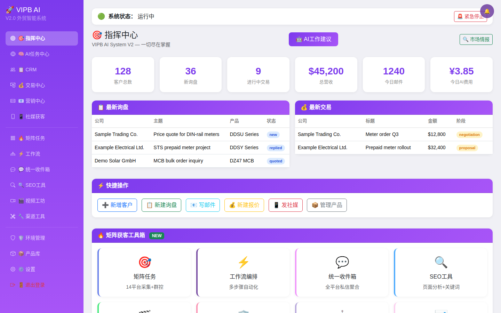
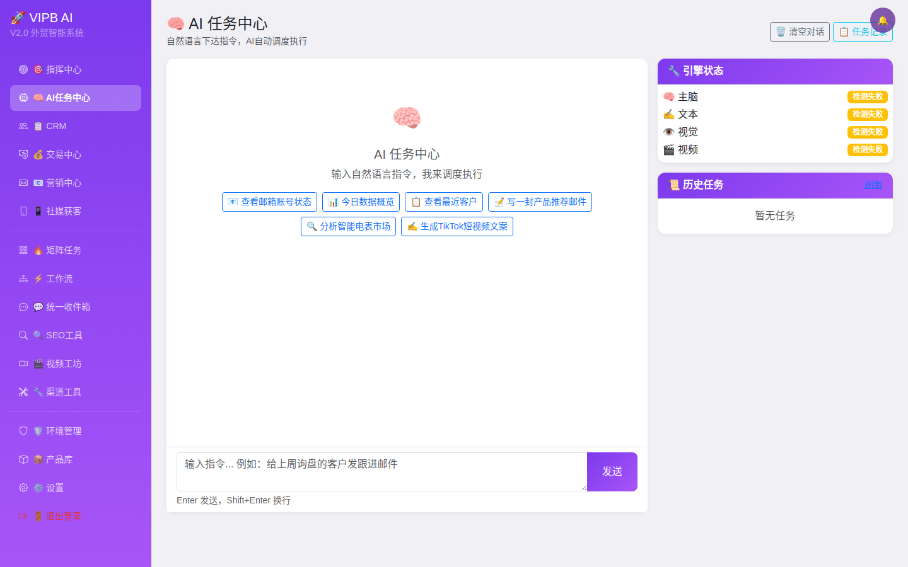
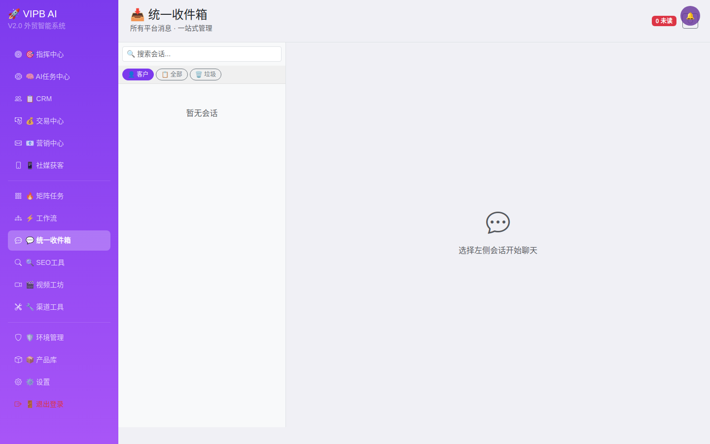
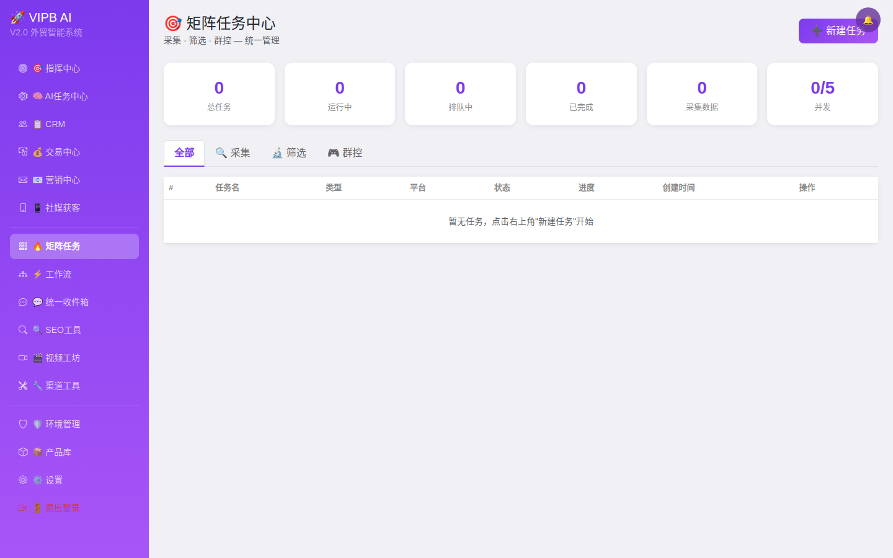
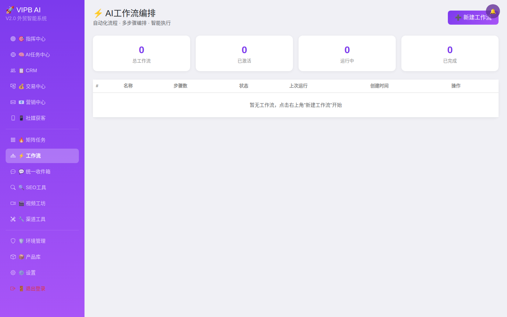
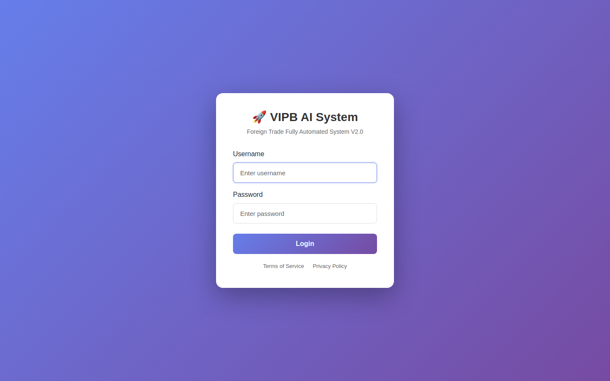
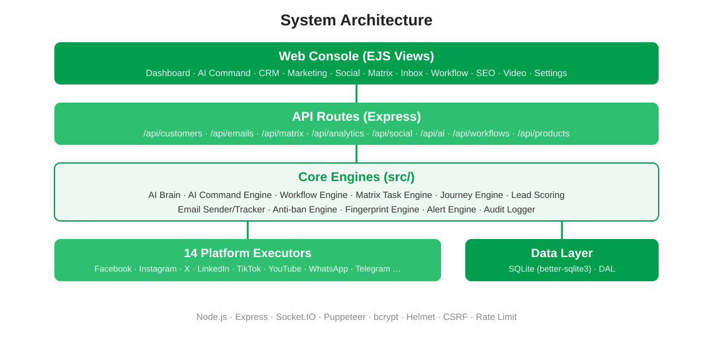

<p align="center">
  
</p>

# VIPB AI System — Foreign Trade Automation System V2

An all-in-one foreign-trade marketing and customer management platform: CRM, email marketing, a 14-platform social matrix, an AI command center and workflow automation in a single self-hosted Node.js application.

> **Project status**: This repository is the archived V2 codebase of VIPB's internal foreign-trade automation system, published for the record. The parts that genuinely ran in day-to-day use were the **account-environment manager** (proxy nodes with a full NekoBox-style feature set, fingerprint-browser profiles, per-account egress), the **email pipeline**, and the **AI command center**; other modules passed page/API-level tests but were not all proven end-to-end. The codebase is provided as-is (see [License](#license)). **Per-module status with the evidence for each claim is listed in [docs/FEATURE-STATUS.md](docs/FEATURE-STATUS.md).**

## Screenshots

| Dashboard | AI Command Center |
|---|---|
|  |  |

| Unified Inbox | Matrix Tasks |
|---|---|
|  |  |

| Workflow | Login |
|---|---|
|  |  |

More screens (SEO tools, video studio, settings) are in [docs/screenshots](docs/screenshots). Screenshots are rendered from the system's own page templates with sample data — see [docs/screenshots/NOTE.md](docs/screenshots/NOTE.md).

## Documentation

- [DEVELOPMENT.md](DEVELOPMENT.md) — developer guide: architecture, subsystems, extension patterns, testing, known issues
- [docs/FEATURE-STATUS.md](docs/FEATURE-STATUS.md) — per-module status with evidence
- [docs/screenshots](docs/screenshots) — UI screenshots
- [THIRD-PARTY-NOTICES.md](THIRD-PARTY-NOTICES.md) — third-party licenses

## Architecture

<p align="center">
  
</p>

## Features

- **Account environments** — NekoBox-style proxy-node manager (subscription import, all major protocols, speed tests, proxy chains), fingerprint-browser profiles with AdsPower / Multilogin / GeeLark adapters, per-account egress binding
- **CRM** — customer records, lead scoring, customer-journey engine, automatic follow-ups
- **Email marketing** — templates, bulk sending with pacing and anti-ban rules, open/click tracking, auto-replies
- **AI Command Center** — natural-language instructions routed by the AI command engine to the right module
- **Social matrix** — multi-account management and scheduled publishing across 14 platforms (Facebook, Instagram, X, LinkedIn, TikTok, YouTube, Pinterest, Reddit, WhatsApp, Telegram, Google Business, Alibaba, and more)
- **Matrix tasks & workflows** — multi-step automated collection and outreach pipelines
- **Unified inbox** — direct messages from all platforms in one place
- **Analytics** — multi-dimensional statistics, conversion funnel, real-time dashboard over Socket.IO
- **SEO & video tools** — page analysis, keyword tools, short-video workshop
- **Security** — bcrypt password hashing, CSRF protection, rate limiting, TOTP two-factor support, audit logging, emergency-stop switch

## Tech Stack

- **Runtime**: Node.js + Express
- **Database**: SQLite via better-sqlite3 (data access layer in `src/dal.js`)
- **Views**: EJS templates + Bootstrap 5
- **Automation**: Puppeteer (with stealth plugin), browser fingerprint engine
- **Real-time**: Socket.IO
- **Security**: Helmet, csurf, bcrypt, express-rate-limit, express-session

## Quick Start

```bash
# 1. Install dependencies
npm install

# 2. Configure
cp .env.example .env   # then fill in your own secrets

# 3. Start
node server.js

# 4. Open
http://localhost:3001
```

**First login**: on first start the system creates the initial `admin` account. Its password is taken from the `INITIAL_ADMIN_PASSWORD` environment variable; if that variable is not set, a random password is generated and printed once in the startup log — save it and change it after your first login. There is no built-in default password.

## Project Structure

```
server.js            # Entry point: route registration and middleware
src/                 # Core engines
  ├── ai-brain.js            # AI decision engine
  ├── ai-command-engine.js   # Natural-language command routing
  ├── ai-content-generator.js
  ├── dal.js                 # Data access layer
  ├── email-sender.js / email-tracker.js
  ├── antiban-engine.js      # Anti-ban pacing rules
  ├── fingerprint-engine.js  # Browser fingerprints
  ├── journey-engine.js      # Customer journey
  ├── lead-scoring.js
  ├── matrix-task-engine.js
  ├── social-publisher.js
  ├── workflow-engine.js
  └── platforms/             # 14 platform executors
routes/              # API routes (customers, email, matrix, analytics, social, ai, workflows, products)
views/               # EJS page templates
public/              # Static assets
scripts/             # Operations and check scripts
tests/               # Jest tests
```

## Configuration

All configuration is via environment variables — see `.env.example` for the full list (server port, session secret, credential encryption key, initial admin password, mail and AI provider keys). Never commit a real `.env` file.

## API Overview

| Prefix | Description |
|---|---|
| `/api/customers` | Customer CRUD |
| `/api/emails` | Email management |
| `/api/matrix` | Matrix tasks |
| `/api/analytics` | Analytics |
| `/api/social` | Social accounts |
| `/api/ai` | AI features |
| `/api/workflows` | Workflow management |
| `/api/products` | Product management |

## License

This project is licensed under the MIT License — Copyright (c) 2026 **Wenzhou Xingyuan Holding Co., Ltd.** See [LICENSE](LICENSE). Third-party components remain under their own licenses — see [THIRD-PARTY-NOTICES.md](THIRD-PARTY-NOTICES.md).

---

## 中文概要

VIPB AI 外贸全自动化系统 V2：集 CRM 客户管理、邮件营销、14 个平台社媒矩阵、AI 指挥中心、工作流自动化于一体的自托管 Node.js 系统（Express + SQLite + EJS + Puppeteer）。本仓库为该系统 V2 代码的存档发布：邮件发送链路曾为日常在用模块，其余模块为完整实现但未全部投入生产。快速开始见上文 Quick Start；首次启动创建初始管理员 admin，口令由环境变量 INITIAL_ADMIN_PASSWORD 决定，未设置时随机生成并在启动日志打印一次，无内置默认口令。版权归温州星源控股有限公司所有，采用 MIT 协议开源，详见 LICENSE。
